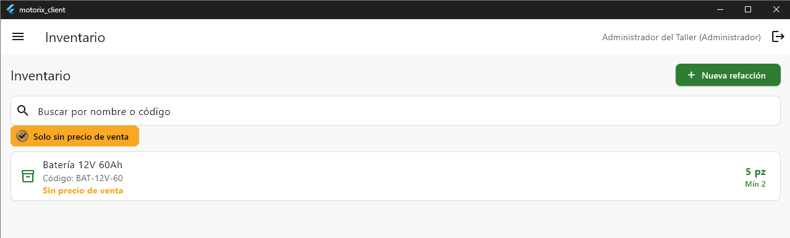
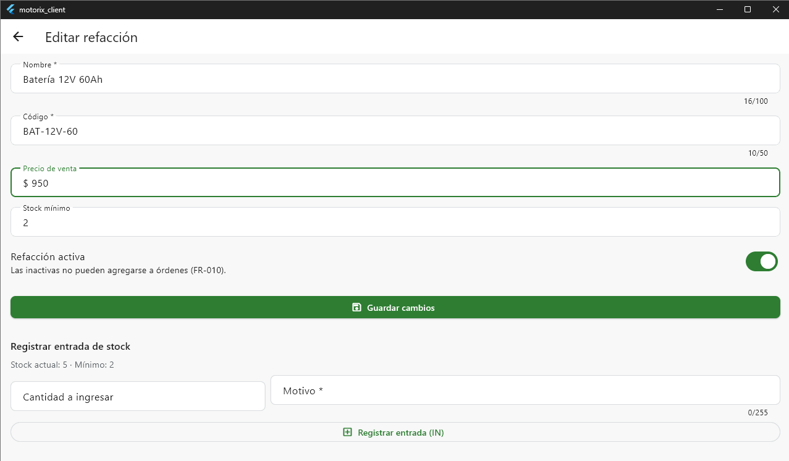
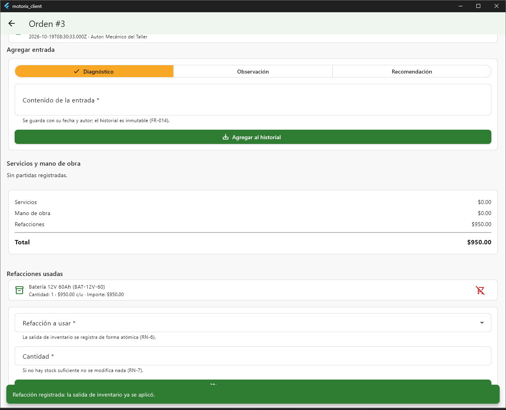
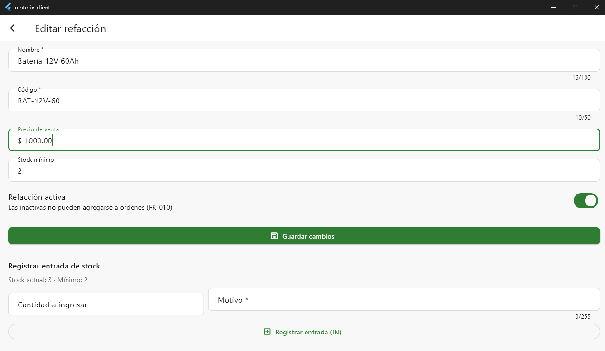

# Aseguramiento de la calidad - Sprint 5: Precio de venta de refacciones

Este documento es el registro de calidad del Sprint 5 de Motorix. Reúne las puertas de calidad, las decisiones, los riesgos, la trazabilidad de los criterios de aceptación, los hallazgos y la regresión de los sprints anteriores. Incluye además el control de calidad final (sección 9), el cierre (sección 10) y el anexo de evidencias, cerrados el 2026-11-02.

**Aviso de método.** El aseguramiento de este sprint se documentó **después de implementar**, no antes. La implementación terminó el 2026-10-18 y este documento se compiló el 2026-11-02. Por eso hay dos puertas ejecutadas después: el checklist de calidad de requisitos (G-04) se generó y evaluó el 2026-11-02, y la línea base de Flutter se midió el 2026-11-02 sobre el commit `fef7e92`. El documento no presenta esas actividades como si hubieran ocurrido antes del código.

Resultado general: el sprint se aprobó con observaciones el 2026-11-02.

## 0. Datos del documento

| Campo | Valor |
|---|---|
| Sprint | 5 - Precio de venta de refacciones (versión propia del Sprint 5: solo precio de venta, total, cobro y ticket) |
| Insumo | No hubo archivo de insumo formal: `docs/sprints/` no contiene un archivo del Sprint 5 (solo `sprint-1` a `sprint-4` y `_plantilla.md`). Ver G-01 |
| Especificación | `specs/005-precio-venta-refacciones/` (16 FR, 21 CA, 7 SC en `spec.md`) |
| Rama de trabajo del sprint | `005-precio-refacciones` |
| Rama de este documento | `aseguramiento-calidad-005` |
| Base | `main` (commit `fef7e92`, 2026-10-14) |
| Responsable | Raúl Francisco Amador, Product Builder |
| Aprobador del cierre | Raúl Francisco Amador, Product Builder |
| Fecha de inicio | 2026-10-18 (línea base de backend, commit `0273fb7`) |
| Implementación terminada | 2026-10-18 (commit `b33ea9b`) |
| Capturas de la aplicación | 2026-10-19 (commit `78d2a7e`) |
| Documento compilado | 2026-11-02 (después de implementar) |
| Fecha de cierre | 2026-11-02 |
| Estado general | Aprobado con observación |
| Herramienta del ciclo Spec Kit | Spec Kit con OpenCode, modelo MiMo-V2.6-Flash (ciclo `specify`, `clarify`, `plan`, `tasks`, `analyze`, `implement`) |
| Herramienta de la lista de calidad | Spec Kit con OpenCode, modelo MiMo-V2.6-Flash (`/speckit.checklist`, ejecutado el 2026-11-02) |
| Herramienta de redacción de este documento | Claude Code |
| Guía y plantilla | Elaboradas por el equipo: `docs/aseguramiento-calidad/guia-aseguramiento-calidad.md` y `docs/aseguramiento-calidad/plantilla-aseguramiento-calidad.md` |

## 1. Objetivo y alcance

**Objetivo.** Asegurar que el Sprint 5 salga con calidad: que los requisitos estén completos, sean medibles y no se contradigan, que las pruebas estén planeadas antes del código y que el cambio no rompa lo construido en los sprints anteriores.

**Dentro del alcance** (según `specs/005-precio-venta-refacciones/spec.md`):

- Precio de venta en la ficha de cada refacción, con registro y modificación solo para administración (FR-001, FR-002).
- Detección de refacciones activas sin precio (pendientes de precio) en el inventario (FR-003).
- Precio congelado en cada uso de refacción dentro de una orden, y rechazo de refacciones sin precio (FR-004 a FR-006).
- Total de la orden con servicios, mano de obra y refacciones (precio × cantidad), con marca de total incompleto (FR-007, FR-008).
- Adopción del precio asignado en las órdenes abiertas no liquidadas (FR-011).
- Cobro y ticket con el total completo y el desglose de refacciones, con bloqueo por total incompleto en órdenes no liquidadas (FR-009, FR-010, FR-012 a FR-014, FR-016).
- Datos de ejemplo con precios definidos (FR-015).

**Fuera del alcance:**

- Lo que declara `spec.md` (líneas 161 a 166): precio de compra y su captura; reportes de utilidad, margen, costo o rentabilidad; recalcular retroactivamente órdenes ya pagadas; modificar los specs de los sprints 1 a 4.
- Además, para este sprint: la categoría y la marca de la refacción, el precio de compra y su visibilidad por rol, y los pagos pendientes de Mercado Pago desfasados. Quedan para un sprint posterior.

## 2. Criterios de entrada y de salida

Los criterios de entrada se evalúan contra el estado antes de comenzar la implementación (primer commit de código: `c577ba8`, 2026-10-18). Los de salida se evalúan al cierre, el 2026-11-02.

**Criterios de entrada (para comenzar la implementación):**

- [ ] Las 8 puertas de la sección 3 están Aprobadas o Aprobadas con observación **antes** de implementar. No se cumplió en tiempo: 7 puertas estaban ejecutadas antes de `c577ba8`; G-04 se ejecutó el 2026-11-02, después de implementar.
- [x] Si el sprint exige un cambio a la constitución del proyecto, la enmienda está aprobada y registrada. No aplica: `plan.md` (sección «Comprobación de la constitución») no registra violaciones y no hay enmienda.
- [x] Las decisiones de la sección 4 están resueltas y registradas en `spec.md` (sección «Clarifications»).
- [x] No hay hallazgos críticos ni altos abiertos en el análisis de consistencia: el análisis (`607ccbd`) tuvo 0 críticos y 2 altos, y ambos se remediaron en `7ba97da`, antes del primer commit de código.
- [x] Cada criterio de aceptación tuvo al menos una prueba planeada (sección 6): el análisis registra 20 de 20 CA con tarea; CA-21 se agregó después con T025.
- [ ] La línea base de regresión está registrada **antes** del código. Se cumplió solo para el backend (`0273fb7`, 2026-10-18); la de Flutter se midió el 2026-11-02.
- [x] La documentación desfasada de los sprints anteriores está identificada: `specs/004-pagos-tickets-dashboard/informe-finalizacion.md` (líneas 124 a 128) registra que el total del Sprint 4 excluyó las refacciones por falta de precio, y `spec.md` (línea 51) cita esa brecha.

**Criterios de salida (para cerrar el sprint):**

- [x] Los 21 criterios de aceptación están Aprobados. Se cumplió con observación: 19 están Aprobados y 2 están Aprobados con observación (CA-10 y CA-15, sección 6); ninguno está Fallido. Los dos tienen un escenario del guion del quickstart contra la API real, pero no un caso automatizado en Jest (H-07).
- [x] Todas las pruebas de los sprints anteriores siguen pasando. Se cumplió con observación: backend 58 suites y 260 pruebas aprobadas, Flutter 28 pruebas aprobadas, 0 fallidas (sección 8); 4 aserciones del backend se ajustaron por el cambio de contrato declarado y en Flutter no se revisaron línea por línea (H-11).
- [x] No hay defectos críticos ni altos abiertos (sección 7): los 2 altos, H-01 y H-02, están resueltos.
- [x] La matriz de calidad final (sección 9) está completa, con evidencia: cinco requisitos con sus bloques E-01 a E-05 y el recorrido E-06 en el anexo.
- [x] Reporte, análisis y matriz no se contradicen. Se cumplió con observación: los conteos, las fechas y los commits de las secciones 6, 8, 9 y 10 coinciden; las diferencias entre los datos de ejemplo del spec y los de las pruebas (CA-4 y CA-5) se declaran en el anexo (E-04).

## 3. Puertas de calidad

El detalle de cada puerta está en los documentos citados en la columna de evidencia. Los hashes y las fechas salen de `git log`.

| ID | Puerta | Estado | Evidencia |
|:--:|---|---|---|
| G-01 | Insumo del sprint revisado contra el código | Aprobado con observación | No hubo insumo formal en `docs/sprints/` (no existe un archivo del Sprint 5). La justificación se apoya solo en documentos del repositorio: [`docs/project-context.md`](project-context.md) (líneas 288 y 289 listan «Precio de venta» como dato del inventario) y el Sprint 4 ([`specs/004-pagos-tickets-dashboard/spec.md`](../specs/004-pagos-tickets-dashboard/spec.md), FR-003, línea 112; e [`informe-finalizacion.md`](../specs/004-pagos-tickets-dashboard/informe-finalizacion.md), líneas 124 a 128, que registra que el total del Sprint 4 excluyó las refacciones por falta de precio) |
| G-02 | Especificación (`/speckit.specify`) | Aprobado con observación | [`spec.md`](../specs/005-precio-venta-refacciones/spec.md), commit `37748a7` (2026-10-18). Hoy tiene 16 FR (EARS), 21 CA y 7 SC; [`checklists/requirements.md`](../specs/005-precio-venta-refacciones/checklists/requirements.md) tiene 16 de 16 casillas marcadas. Observación: el encabezado de `spec.md` (línea 7) sigue en «Estado: Borrador» |
| G-03 | Aclaraciones (`/speckit.clarify`) | Aprobado | 2 rondas el 2026-10-18 más la directiva de reescritura EARS: ronda 1 (`22ae286`: precio de las refacciones existentes, «abierta» frente a «pagada», filtro de pendientes) con la directiva de dividir los requisitos compuestos en requisitos EARS de una sola respuesta, y ronda 2 (`3a9d461`: adopción en órdenes con pagos parciales y precios en los datos de ejemplo). Después del análisis hubo 2 decisiones más (INC-01 y AMB-01, en `7ba97da`). Sin marcadores `[NEEDS CLARIFICATION]` en `spec.md` (comprobado con búsqueda) |
| G-04 | Lista de calidad de requisitos (`/speckit.checklist`) | Aprobado con observación | [`checklists/precio-total.md`](../specs/005-precio-venta-refacciones/checklists/precio-total.md), 40 ítems, **ejecutado después de implementar** (commit `ca67e2a`, 2026-11-02). Evaluado en [`evaluacion-checklist-precio-total.md`](evidencias/aseguramiento/evaluacion-checklist-precio-total.md) (commit `ff5840b`): 8 Cumple, 20 Cumple con observación, 12 Hueco y 11 hallazgos (HC-01 a HC-11). Observación: el spec no se cambió, así que los 11 hallazgos siguen abiertos (sección 7) y las 40 casillas del checklist siguen sin marcar |
| G-05 | Plan (`/speckit.plan`) | Aprobado | Commit `e3f137a` (2026-10-18): [`plan.md`](../specs/005-precio-venta-refacciones/plan.md) (comprobación de los 8 principios de la constitución sin violaciones), [`research.md`](../specs/005-precio-venta-refacciones/research.md), [`data-model.md`](../specs/005-precio-venta-refacciones/data-model.md), [`contracts/api-rest.md`](../specs/005-precio-venta-refacciones/contracts/api-rest.md) y [`quickstart.md`](../specs/005-precio-venta-refacciones/quickstart.md). La migración es aditiva: `016_add_part_prices.sql` sin editar la 001 a la 015 |
| G-06 | Tareas (`/speckit.tasks`) | Aprobado | Commit `32d2450` (2026-10-18): [`tasks.md`](../specs/005-precio-venta-refacciones/tasks.md) con 34 tareas (T001 a T034) agrupadas por historia; las pruebas van antes del código en las tres historias. T035 se agregó durante la implementación, en el commit `2b1d476` (ver H-10) y hoy el archivo tiene 35 tareas |
| G-07 | Consistencia (`/speckit.analyze`) | Aprobado con observación | [`analisis-005.md`](evidencias/analisis-005.md) (commit `607ccbd`): 0 críticos, 2 altos, 3 medios y 4 bajos; cobertura de 15 de 15 FR y 20 de 20 CA. Remediación en [`remediacion-005.md`](evidencias/remediacion-005.md) (commit `7ba97da`). Observación: solo hay un pase documentado; no hay un segundo `analyze` posterior a la remediación que confirme cero hallazgos |
| G-08 | Pruebas planeadas y línea base | Aprobado con observación | Los 21 CA tienen prueba planeada en `tasks.md` (T006 a T027, antes del código) y la sección 6 los enlaza. Línea base del backend: 49 suites y 223 pruebas, commit `0273fb7`, 2026-10-18 ([`pruebas-backend-base.txt`](evidencias/pruebas-backend-base.txt)). El recorrido del quickstart tiene un guion versionado ([`quickstart-005.mjs`](evidencias/aseguramiento/quickstart-005.mjs)) con una corrida de 62 de 62 verificaciones y código de salida 0 ([`quickstart-005-corrida.txt`](evidencias/aseguramiento/quickstart-005-corrida.txt)); la primera corrida (54 de 61) se conserva en [`quickstart-005-corrida-1-base-contaminada.txt`](evidencias/aseguramiento/quickstart-005-corrida-1-base-contaminada.txt) (ver H-12 y H-14). Observación: la línea base de Flutter (17 pruebas) se midió el 2026-11-02 sobre `fef7e92`, después de implementar ([`pruebas-flutter-base.txt`](evidencias/aseguramiento/pruebas-flutter-base.txt)) |

## 4. Decisiones de aclaración

No hubo insumo formal con decisiones D-01 a D-NN. Las decisiones abiertas surgieron durante `/speckit.specify` y se resolvieron el 2026-10-18 en dos rondas de `/speckit.clarify` (más una sesión posterior al análisis), con la aprobación de Raúl Francisco Amador. El texto completo está en `specs/005-precio-venta-refacciones/spec.md`, sección «Clarifications» (líneas 11 a 25).

| ID | Decisión | Resolución | Requisito afectado |
|:--:|---|---|---|
| D-01 | Precio de las refacciones existentes | Quedan pendientes de precio y no se usan en una orden hasta que administración asigne uno; los datos de ejemplo traen precio | FR-003, FR-005, FR-015 |
| D-02 | «Abierta» frente a «pagada» | Son dos dimensiones independientes: abierta es no entregada y no cancelada; pagada es que los pagos alcanzan el total | FR-007 a FR-010 |
| D-03 | Detectar refacciones sin precio | Es requisito: el inventario las lista o filtra | FR-003, CA-17 |
| D-04 | Directiva de reescritura EARS | Se dividieron los requisitos compuestos en requisitos de una sola respuesta, con el patrón «Mientras» donde corresponde | FR-006 a FR-010 |
| D-05 | Órdenes con pagos parciales y usos sin precio | Adoptan el precio asignado; los pagos se conservan y el saldo se ajusta | FR-011, CA-19 |
| D-06 | Usos en las órdenes de ejemplo | Todos traen precio registrado; ninguna orden de ejemplo queda incompleta | FR-015, CA-20 |
| D-07 | Orden liquidada con usos sin precio (INC-01 del análisis) | No se bloquea: conserva su total histórico y su ticket marca las líneas «sin precio» | FR-016, CA-21 |
| D-08 | Total con el que se evalúa «no liquidada» (AMB-01 del análisis) | El total previo a la adopción; una orden ya pagada nunca adopta | FR-011 |

## 5. Riesgos y mitigaciones

| ID | Riesgo | Impacto | Mitigación | Prueba que lo cubre | Estado |
|:--:|---|---|---|---|---|
| R-01 | Un cambio de precio altera el total de órdenes ya calculadas | Alto: se cobraría un importe distinto al acordado | El uso conserva el precio vigente al agregarse (FR-004, FR-006) | `server/tests/integration/order-totals-parts.test.js:139` (CA-4) y `:164` (CA-5) | Mitigado |
| R-02 | Una refacción sin precio entra a una orden y subvalora el total | Alto: cobro incorrecto | Rechazo con `PART_SIN_PRECIO` sin tocar orden ni stock | `server/tests/integration/order-parts-rejection.test.js:79` (CA-8) | Mitigado |
| R-03 | Se cobra o se imprime un ticket con total incompleto | Alto: importe incorrecto frente al cliente | Bloqueo `TOTAL_INCOMPLETO` en cobro, cobro digital y ticket de órdenes no liquidadas | `server/tests/integration/payments-parts-total.test.js:144` y `:182`; `server/tests/integration/tickets-parts.test.js:112` | Mitigado |
| R-04 | La adopción del precio altera una orden ya pagada, entregada o cancelada | Alto: cambia un importe cobrado | La adopción se limita a órdenes no entregadas ni canceladas y no liquidadas con el total previo | `server/tests/integration/part-price-adoption.test.js:143` y `:198`; caso total cero en `:172` (H-10) | Mitigado |
| R-05 | Mecánico o recepción modifica el precio | Alto: manipulación de importes | `requireRole('ADMIN')` en las rutas de alta y edición, verificado en servidor | `server/tests/contract/parts.contract.test.js:173` (CA-16) | Mitigado (ver HC-02) |
| R-06 | Volver a aplicar los seeds duplica o corrompe datos de demostración | Medio: inventario o totales inconsistentes en la base de demostración | Seed 008 (Sprint 5): `stock` en valores absolutos con IDs fijos (H-02). Seed 004 (Sprint 2): sin mitigación; no es idempotente (H-14) | Escenario E1 de [`quickstart-005.mjs`](evidencias/aseguramiento/quickstart-005.mjs), corrida de 62 de 62 ([`quickstart-005-corrida.txt`](evidencias/aseguramiento/quickstart-005-corrida.txt)): tras aplicar los seeds dos veces, el seed 008 mantiene refacciones 8 a 8, usos 2 a 2, movimientos 10 a 10 y el stock de cada refacción sin cambio. El seed 004 no los mantiene: orden 2, servicios de 2 filas (600) a 6 filas (1800) y mano de obra de 1 fila (500) a 3 filas (1500); orden 4, servicios de 2 filas (950) a 6 filas (2850) y mano de obra de 1 fila (400) a 3 filas (1200) | Mitigado para el seed 008. Seed 004: Aceptado (H-14) |
| R-07 | El cambio de contrato rompe pruebas de sprints anteriores | Medio: regresión | Suite completa antes y después; los ajustes se registran (H-11) | Sección 8: 223 y 260 pruebas aprobadas, 0 fallidas | Mitigado |
| R-08 | Uso concurrente al agregar refacciones o cambiar precios (HC-09) | Bajo: carrera poco probable en un taller de un usuario por mostrador | Bloqueo de fila en `server/models/inventory.js:32` al agregar; la adopción no bloquea | Ninguna: no hay prueba de concurrencia | Aceptado |
| R-09 | Fallo entre la edición del precio y la adopción (HC-08) | Medio: precio asignado sin adoptar en órdenes abiertas | Reintentar es seguro (`unit_price IS NULL`); sin transacción hoy | Ninguna: no hay prueba de fallo | Abierto |
| R-10 | Orden entregada y no liquidada con usos sin precio queda sin salida (HC-11) | Medio: no se puede cobrar ni emitir ticket | Ninguna todavía; resolución propuesta en HC-11 | Ninguna | Abierto |
| R-11 | Retirar una refacción deja pagos mayores al nuevo total (HC-07) | Medio: sobrepago sin registro | El saldo se recorta a 0 (`server/services/payment-service.js:105`); no se registra el exceso | Ninguna | Abierto |
| R-12 | Un `PUT` con precio vacío borra el precio de una refacción que ya lo tenía (HC-10) | Medio: refacción vuelve a pendiente sin aviso | Ninguna todavía; resolución propuesta en HC-10 | `server/tests/integration/parts-sale-price.test.js:69` prueba que se puede limpiar, pero ninguna prueba lo rechaza | Abierto |

## 6. Trazabilidad

Cada criterio de aceptación (CA) se enlaza con su requisito, su tarea, su prueba y el resultado. Los resultados se apoyan en los registros de ejecución ya existentes (`pruebas-backend-final.txt`, `pruebas-flutter-final.txt`, los registros de cierre `pruebas-backend-cierre.txt` y `pruebas-flutter-cierre.txt`, y la corrida del quickstart `quickstart-005-corrida.txt`, generada por el guion versionado `quickstart-005.mjs`; ver la sección 8 y H-12); para este documento **no se ejecutaron las suites**. Los números de línea corresponden a los títulos de las pruebas. En la columna de evidencia, E1 a E10 son los escenarios del guion `docs/evidencias/aseguramiento/quickstart-005.mjs`; los resultados de esos escenarios salen de [`quickstart-005-corrida.txt`](evidencias/aseguramiento/quickstart-005-corrida.txt).

| CA | Criterio de aceptación (resumen) | Requisito (FR) | Tarea | Prueba | Resultado | Evidencia |
|:--:|---|---|---|---|---|---|
| CA-1 | La refacción con precio lo muestra al consultarse; una nueva puede guardarse con precio | FR-001 | T007, T015 | T007, T010 | Aprobado | `server/tests/integration/parts-sale-price.test.js:39`; `client/test/part_price_test.dart:9` |
| CA-2 | Precio negativo o no numérico: error visible, el precio previo no cambia | FR-001 | T006, T007, T012 | T006, T007 | Aprobado | `server/tests/unit/validators/part-validator-part-price.test.js:24,30`; `server/tests/integration/parts-sale-price.test.js:98` |
| CA-3 | 2 unidades a $150: uso con cantidad 2 y precio $150, stock baja 2 | FR-004 | T017, T021 | T017 | Aprobado | `server/tests/integration/order-totals-parts.test.js:99` |
| CA-4 | Cambio de $150 a $200: el total de la orden que ya la usó sigue en $300 | FR-006 | T017 | T017 | Aprobado | `server/tests/integration/order-totals-parts.test.js:139` |
| CA-5 | El mismo cambio eleva el importe en una orden nueva ($400) | FR-006 | T017 | T017 | Aprobado | `server/tests/integration/order-totals-parts.test.js:164` |
| CA-6 | $1,000 + $500 + 2 refacciones de $150 = $1,800; con una tercera de $100, $1,900 | FR-007 | T016, T017, T020, T023 | T016, T017 | Aprobado | `server/tests/unit/order-totals-parts.test.js:29`; `server/tests/integration/order-totals-parts.test.js:99` |
| CA-7 | Orden sin servicios ni refacciones: total $0 | FR-007 | T016 | T016 | Aprobado | `server/tests/unit/order-totals-parts.test.js:5,17` |
| CA-8 | Refacción sin precio: mensaje claro, total y stock sin cambio | FR-005 | T003, T004, T018, T021 | T018 | Aprobado | `server/tests/integration/order-parts-rejection.test.js:79` |
| CA-9 | Orden abierta no liquidada con uso sin precio: total incompleto con la refacción señalada | FR-008 | T004, T016, T020, T023 | T016, T018 | Aprobado | `server/tests/unit/order-totals-parts.test.js:41`; `server/tests/integration/order-parts-rejection.test.js:124`; `server/tests/integration/payments-parts-total.test.js:144` |
| CA-10 | Cobro y ticket se rechazan con total incompleto, y vuelven a funcionar tras asignar el precio | FR-009, FR-010 | T024, T025, T028, T029 | T024, T025, T026 | Aprobado con observación | `server/tests/integration/payments-parts-total.test.js:144,182`; `server/tests/integration/tickets-parts.test.js:112` (bloqueo). Reintento tras asignar el precio: escenario E10 de `quickstart-005.mjs` (cobro 201 y ticket 200 con total 450 después de asignar el precio; E6 y E7 cubren el bloqueo previo). Observación: el reintento tras asignar el precio está verificado contra la API real por el escenario E10 del guion (62 de 62), pero no existe un caso automatizado en Jest (H-07, abierto); las pruebas planeadas T024 a T026 solo cubren el bloqueo |
| CA-11 | Asignar precio recalcula dos órdenes abiertas no liquidadas; la pagada conserva su total | FR-011 | T019, T022 | T019 | Aprobado | `server/tests/integration/part-price-adoption.test.js:103,143` |
| CA-12 | Total $1,800 y pagos $1,000: saldo $800; al pagarlo, liquidada | FR-012 | T024, T028 | T024 | Aprobado | `server/tests/integration/payments-parts-total.test.js:93` |
| CA-13 | El ticket muestra $1,800 y lista cada refacción con cantidad, precio e importe | FR-014 | T025, T029, T030 | T025, T027 | Aprobado | `server/tests/integration/tickets-parts.test.js:82`; `client/test/ticket_test.dart:195` |
| CA-14 | Total del ticket, de la orden y del cobro idénticos (diferencia $0) | FR-013 | T025, T029 | T025 | Aprobado | `server/tests/integration/tickets-parts.test.js:82` |
| CA-15 | Retirar una refacción de $150 baja el total a $1,650 y repone el stock | FR-007 | T018 | T018 | Aprobado con observación | `server/tests/integration/order-parts-rejection.test.js:160` prueba la baja del total; la reposición de stock la comprueba el escenario E4 de `quickstart-005.mjs` (retiro con 204, total de 2140 a 1940 y stock 11 a 11), no una prueba de Jest. Observación: la reposición del stock está verificada contra la API real por el escenario E4 del guion (62 de 62), no por una prueba de Jest; la prueba planeada T018 solo comprueba la baja del total |
| CA-16 | Mecánico o recepción: el sistema deniega el registro del precio, no solo la interfaz | FR-002 | T009, T013 | T009 | Aprobado | `server/tests/contract/parts.contract.test.js:173` |
| CA-17 | El inventario filtra las refacciones activas sin precio; lista vacía si todas tienen | FR-003 | T008, T014, T015 | T008 | Aprobado | `server/tests/integration/parts-pending-price.test.js:60,87` |
| CA-18 | Tras la instalación, las refacciones de ejemplo muestran precio; una existente sin precio queda pendiente | FR-015 | T002, T031 | T031 | Aprobado | Escenario E1 de `quickstart-005.mjs` (6 de 6 refacciones de ejemplo con precio; una sola refacción activa sin precio, `BAT-12V-60`). Lo comprueba el guion del quickstart, no una suite de Jest; la observación anterior (evidencia sin guion versionado) quedó cubierta por E1 |
| CA-19 | Orden abierta con pago parcial y uso sin precio: recalcula, conserva el pago y ajusta el saldo | FR-011 | T019, T022 | T019 | Aprobado | `server/tests/integration/part-price-adoption.test.js:103` |
| CA-20 | Ninguna orden de ejemplo aparece con total incompleto | FR-015 | T002, T031 | T031 | Aprobado | Escenario E1 de `quickstart-005.mjs` («Ninguna orden de ejemplo tiene el total incompleto», incompletas: 0). Igual que CA-18: lo comprueba el guion, no Jest |
| CA-21 | Orden liquidada con usos sin precio: ticket con total histórico y líneas «sin precio», sin bloqueo | FR-016 | T025, T029, T030 | T025, T027 | Aprobado | `server/tests/integration/tickets-parts.test.js:139`; `server/tests/integration/payments-parts-total.test.js:203`; `client/test/ticket_test.dart:184` |

## 7. Hallazgos y defectos

Se registra todo lo encontrado en el análisis, en las pruebas y en la lista de calidad de requisitos. Los hallazgos H-01 a H-09 vienen del análisis ([`analisis-005.md`](evidencias/analisis-005.md)); H-10 es el defecto T035; H-11, H-12, H-13 y H-15 son observaciones surgidas al compilar este documento; H-14 surgió al ejecutar el guion del quickstart; HC-01 a HC-11 vienen de la evaluación del checklist y conservan **la severidad exacta** de [`evaluacion-checklist-precio-total.md`](evidencias/aseguramiento/evaluacion-checklist-precio-total.md). Los HC están **Abiertos** con una resolución propuesta: el responsable decide si los acepta. No hay hallazgos críticos ni altos abiertos.

### 7.1 Análisis, defecto T035 y observaciones de este documento

| ID | Descripción | Severidad | Origen | Estado | Resolución | Evidencia |
|:--:|---|---|---|---|---|---|
| H-01 | INC-01: una orden ya liquidada con usos sin precio quedaría sin ticket de por vida | Alta | G-07 | Resuelto | El bloqueo se acota a órdenes no liquidadas; la liquidada emite ticket con las líneas «sin precio» (nuevos FR-016 y CA-21) | `remediacion-005.md`, commit `7ba97da`; `server/tests/integration/tickets-parts.test.js:139` |
| H-02 | INC-03: el seed 008 ajustaba el stock de forma relativa y no era idempotente | Alta | G-07 | Resuelto | El `stock` se fija en valores absolutos con IDs fijos | `remediacion-005.md`, commit `7ba97da`; T002 en `tasks.md` |
| H-03 | AMB-01: el predicado «no liquidada» era circular con el total que se adopta | Media | G-07 | Resuelto | Se evalúa con el total previo a la adopción | `remediacion-005.md`; `spec.md:25`; `server/tests/integration/part-price-adoption.test.js:143` |
| H-04 | INC-02: el filtro de pendientes solo cubría activas y el spec no lo decía | Media | G-07 | Resuelto | FR-003 y CA-17 acotan el filtro a refacciones activas | `remediacion-005.md`; `spec.md:102,135`; `server/tests/integration/parts-pending-price.test.js:60` |
| H-05 | COV-01: faltaba actualizar el contrato de `GET /api/orders/:id` | Media | G-07 | Resuelto | T017 incluye `orders-detail.contract.test.js` | `remediacion-005.md`; `server/tests/contract/orders-detail.contract.test.js` |
| H-06 | AMB-02: CA-5 no tenía un caso explícito | Baja | G-07 | Resuelto | T017 cita CA-5 y hay prueba dedicada | `server/tests/integration/order-totals-parts.test.js:164` |
| H-07 | AMB-03: CA-10 exige que cobro y ticket vuelvan a funcionar tras asignar el precio; no se encontró una prueba que reintente después de asignarlo | Baja | G-07 | Abierto | Propuesta: agregar un caso que asigne el precio y reintente el cobro y el ticket | `server/tests/integration/payments-parts-total.test.js:144`; `server/tests/integration/tickets-parts.test.js:112` (solo prueban el bloqueo). El escenario E10 de `quickstart-005.mjs` sí recorre el reintento (corrida 62 de 62); el caso de Jest sigue pendiente |
| H-08 | DUP-01: la regla de las órdenes pagadas aparece dos veces en los Supuestos | Baja | G-07 | Aceptado | No se consolidó; las dos formulaciones no se contradicen (la remediación no la atendió) | `spec.md:173,174` |
| H-09 | COV-02: el total de `historialVehiculo` con refacciones no tiene prueba automatizada (las pruebas de historial no cambiaron en el sprint) | Baja | G-07 | Abierto | Propuesta: agregar un caso a `server/tests/contract/vehicle-history.contract.test.js`. El escenario E9 de `quickstart-005.mjs` lo recorre y pasa en la corrida de 62 de 62 (el historial del vehículo 3 coincide con el detalle de la orden 2: 1940; ver H-12) | [`quickstart-005-corrida.txt`](evidencias/aseguramiento/quickstart-005-corrida.txt) |
| H-10 | Defecto T035: `adoptarPrecios` trataba como liquidada a una orden con total previo 0 y cobrado 0, y no adoptaba el precio | Media (clasificada al compilar este documento; ningún documento del repositorio la asigna) | Prueba (T035) | Resuelto | Una orden se considera liquidada solo si su total previo es mayor que cero y lo cobrado lo alcanza. Prueba escrita primero y corrección después | Rojo: [`t035-pruebas-rojo.txt`](evidencias/t035-pruebas-rojo.txt), commit `3c79511`. Verde: [`t035-pruebas-verde.txt`](evidencias/t035-pruebas-verde.txt), commit `2b1d476`. `server/tests/integration/part-price-adoption.test.js:172` |
| H-11 | Ajuste de pruebas de la línea base por la ampliación declarada del contrato: 4 aserciones del backend cambiaron (forma de `totals` en `orders-detail.test.js` y `orders-work.test.js`; `refacciones` y total 300 a 400 en `tickets.contract.test.js`). `SC-007` pedía no cambiar aserciones | Baja | Regresión | Aceptado | Los cambios son consecuencia de FR-007 y FR-013; ninguna prueba se borró ni se debilitó. En Flutter se reestructuraron los dobles de `payment_flow_test.dart` y `ticket_test.dart`; no se revisó línea por línea que sus aserciones se mantuvieran | `git diff fef7e92 b33ea9b` sobre `server/tests/` y `client/test/` |
| H-12 | La evidencia del quickstart que había al compilar este documento ([`validacion-quickstart-005.txt`](evidencias/validacion-quickstart-005.txt) en `HEAD`) terminaba en 37 de 42 verificaciones y código de salida 1 (escenarios 5, 6 y 8). El árbol de trabajo traía una versión sin confirmar con 43 de 43 y código 0. Las 5 fallas se atribuyeron al guion de validación, que no estaba versionado en el repositorio. **Escenario 8 (comprobado):** la orden 2 pertenece al vehículo 3 (`database/seeds/004_demo_service_orders.sql:9`) y el guion consultaba el vehículo 1. **Escenarios 5 y 6 (causa probable, no demostrada):** la orden de prueba no quedaba incompleta; la versión corregida agrega la verificación de esa preparación. El bloqueo existe en `server/services/payment-service.js:120,164-165` y `server/services/ticket-service.js:75-77`, y lo prueban `server/tests/integration/payments-parts-total.test.js:144` y `:182` y `server/tests/integration/tickets-parts.test.js:112` | Media (clasificada al compilar este documento; por ahora) | T031 | Resuelto | Guion versionado [`quickstart-005.mjs`](evidencias/aseguramiento/quickstart-005.mjs) y corrida de 62 de 62 verificaciones con código de salida 0 el 2026-11-02, sobre la base `motorix_test` ([`quickstart-005-corrida.txt`](evidencias/aseguramiento/quickstart-005-corrida.txt)). La base de pruebas se recreó antes de la corrida (borrado y creación de `motorix_test`, migraciones 001 a 016 y seeds 001 a 008 aplicados una sola vez), según el procedimiento ejecutado por el responsable; el archivo de la corrida no registra ese procedimiento. El escenario E9 cubre el historial del vehículo 3, y E6 y E7 verifican la preparación de la orden incompleta antes de cobrar o emitir el ticket. La primera corrida (54 de 61, 7 fallos) quedó conservada en [`quickstart-005-corrida-1-base-contaminada.txt`](evidencias/aseguramiento/quickstart-005-corrida-1-base-contaminada.txt); sus fallos se debieron a datos duplicados por el seed 004 (H-14), no a la lógica de totales del Sprint 5 | `git diff docs/evidencias/validacion-quickstart-005.txt` (origen del hallazgo); [`quickstart-005.mjs`](evidencias/aseguramiento/quickstart-005.mjs); [`quickstart-005-corrida.txt`](evidencias/aseguramiento/quickstart-005-corrida.txt) |
| H-13 | En `tasks.md` siguen sin marcar T031 a T035, aunque T035 tiene commits de rojo y verde y hay cambios sin confirmar en la evidencia del quickstart (T031) y en `database/README.md`. Este último corresponde a T033 («actualizar `database/README.md` con la migración 016 y el seed 008», `tasks.md:132`): son 35 líneas nuevas, las secciones «Migraciones» (001 a 016) y «Seeds» (001 a 008), y sigue sin commit. Los nombres de las migraciones 001 a 015 y de los seeds 001 a 007 que lista el diff coinciden con los archivos reales de `database/migrations` y `database/seeds`; no hay diferencias. El diff también lista las migraciones 001 a 015 y los seeds 001 a 007 ya existentes, más de lo que pide T033 | Baja | G-06 | Abierto | Marcar las tareas cuando el responsable confirme los cambios | `specs/005-precio-venta-refacciones/tasks.md:130-134`; `git status` |
| H-14 | El seed `database/seeds/004_demo_service_orders.sql` (Sprint 2) no es idempotente: `order_services` y `order_labor` no tienen llave única (solo la clave primaria autoincremental), por lo que cada `apply-seeds.mjs` vuelve a insertar las filas de las órdenes 2 y 4. En la corrida 2, tras aplicar los seeds dos veces, la orden 2 pasó de 2 filas de servicios (600) a 6 (1800) y de 1 fila de mano de obra (500) a 3 (1500); la orden 4, de 2 filas (950) a 6 (2850) y de 1 (400) a 3 (1200). En la corrida 1, sobre una base ya contaminada, el total de la orden 2 salió en 4140 en lugar de 1940 (servicios 1800, mano de obra 1500, refacciones 840). La lógica de totales del Sprint 5 no tenía defecto. Solo afecta datos de demostración al re-aplicar seeds; no afecta el producto | Baja | Ejecución del guion del quickstart (E1); defecto heredado del Sprint 2 | Aceptado | Se acepta y no se corrige en este sprint. Corrección propuesta para el sprint de complemento: una restricción única en `order_services` y `order_labor`, o una limpieza previa de esas filas en el seed 004. El guion mide y registra el hallazgo sin ocultarlo y restaura la base de pruebas | [`quickstart-005-corrida-1-base-contaminada.txt`](evidencias/aseguramiento/quickstart-005-corrida-1-base-contaminada.txt); [`quickstart-005-corrida.txt`](evidencias/aseguramiento/quickstart-005-corrida.txt); `database/seeds/004_demo_service_orders.sql:15-25` |
| H-15 | `remediacion-005.md` (línea 35) nombra hallazgos bajos «AMT-01, AMT-02, COV-02, TST-01» que no existen en el análisis (allí son AMB-02, AMB-03, DUP-01 y COV-02) | Baja | G-07 | Abierto | Corregir el texto de la remediación o aclararlo en una nota | `docs/evidencias/remediacion-005.md:35`; `docs/evidencias/analisis-005.md:150-152` |

### 7.2 Hallazgos de la lista de calidad de requisitos (G-04)

Todos con estado **Abierto**. La columna «Resolución propuesta» es una propuesta para el responsable; no se aplicó ningún cambio al spec.

| ID | Descripción | Severidad | Origen | Estado | Resolución propuesta | Evidencia |
|:--:|---|---|---|---|---|---|
| HC-01 | SC-006 usa «unos segundos» sin umbral | Baja | G-04 (CHK008) | Abierto | Fijar un umbral (por ejemplo, 2 s) y decir cómo se mide | `spec.md:158`; evaluación, sección 2 |
| HC-02 | CA-16 no define el mensaje ni el estado de la denegación ni que el precio quede intacto | Baja | G-04 (CHK011) | Abierto | Precisar el mensaje y agregar a la prueba la comprobación de que el precio no cambió | `spec.md:134`; `server/tests/contract/parts.contract.test.js:173` |
| HC-03 | El criterio «no liquidada = pagos < total previo a la adopción» no está en ningún FR ni CA | Media | G-04 (CHK017) | Abierto | Subirlo a FR-011 y CA-19. El código y dos pruebas ya lo cubren | `spec.md:25,110,137`; `server/models/part.js:117-148` |
| HC-04 | El destino de las órdenes entregadas o canceladas solo es supuesto y caso límite | Baja | G-04 (CHK022) | Abierto | Agregar un FR o CA. El código y una prueba ya lo cubren | `spec.md:178`; `server/tests/integration/part-price-adoption.test.js:198` |
| HC-05 | Los casos límite y los escenarios de US1 a US3 no tienen identificadores FR/CA; faltan CA para orden pagada no entregada, orden cerrada y precio $0 | Baja | G-04 (CHK023, CHK032) | Abierto | Mapear los casos límite a FR/CA y agregar los tres CA | `spec.md:85-94` |
| HC-06 | Falta un CA para agregar una refacción a una orden pagada y abierta | Media | G-04 (CHK024) | Abierto | Agregar el CA y una prueba. El código lo permite | `spec.md:91`; `server/services/payment-service.js:105` |
| HC-07 | No se define qué pasa si los pagos superan el nuevo total tras retirar una refacción | Media | G-04 (CHK025) | Abierto | Definir el comportamiento (sobrepago o saldo a favor) y probarlo | `server/services/payment-service.js:105` |
| HC-08 | FR-011 no define el error durante la adopción y `part-service.js` hace dos operaciones sin transacción | Media | G-04 (CHK026) | Abierto | Definir el flujo de error y envolver la edición y la adopción en una transacción | `server/services/part-service.js:91-115` |
| HC-09 | No hay requisito de uso concurrente al agregar refacciones o cambiar precios | Baja | G-04 (CHK027) | Abierto | Declarar el supuesto o agregar el requisito. La fila se bloquea al agregar; la adopción no | `server/models/inventory.js:32` |
| HC-10 | El caso límite («no se admite el precio vacío») contradice el contrato y el código, donde vacío o `null` significa «pendiente»; un `PUT` con vacío borra el precio existente | Media | G-04 (CHK029) | Abierto | Decidir cuál regla rige, escribirla en un FR o CA y ajustar validador y pruebas | `server/validators/part-validator.js:46-50`; `server/tests/integration/parts-sale-price.test.js:69` |
| HC-11 | FR-008 dice «abierta», FR-009 y FR-010 dicen «no liquidada» y el Supuesto dice «abierta no liquidada»; una orden ENTREGADO sin liquidar con usos antiguos sin precio no se puede cobrar, no emite ticket y no adopta el precio | Media | G-04 (CHK033) | Abierto | Unificar la redacción y decidir cómo se desbloquea ese caso (por ejemplo, adopción también en entregadas no liquidadas) | `server/services/payment-service.js:56-65,81-84`; `server/services/ticket-service.js:75`; `server/models/part.js:147` |

**Resumen:** 26 hallazgos registrados (H-01 a H-15 y HC-01 a HC-11). Críticos abiertos: 0. Altos abiertos: 0 (los 2 altos, H-01 y H-02, están resueltos). Medios abiertos: 6 (HC-03, HC-06, HC-07, HC-08, HC-10 y HC-11). Bajos abiertos: 9 (H-07, H-09, H-13, H-15, HC-01, HC-02, HC-04, HC-05, HC-09). Aceptados: 3 (H-08, H-11, H-14). Resueltos: 8 (H-01 a H-06, H-10 y H-12).

## 8. Línea base de regresión

Se ejecutó la suite completa antes de tocar el código del backend, al cierre de la implementación (2026-10-18) y al cierre del sprint (2026-11-02, commit `50bba2f`). Para redactar este documento **no se volvieron a ejecutar las suites**: los conteos salen de los archivos de evidencia. Ninguna prueba de la línea base pasó de verde a rojo según los registros de cierre.

| Suite | Comando | Antes del sprint | Después del sprint | Diferencia | Evidencia |
|---|---|---|---|---|---|
| Backend | `npm test` en `server/` | 49 suites y 223 pruebas aprobadas, 0 fallidas | 58 suites y 260 pruebas aprobadas, 0 fallidas (87.521 s, código de salida 0; cierre 2026-11-02, commit `50bba2f`) | +9 suites y +37 pruebas; duración +12.708 s frente a la línea base | [`pruebas-backend-base.txt`](evidencias/pruebas-backend-base.txt) y [`pruebas-backend-cierre.txt`](evidencias/aseguramiento/pruebas-backend-cierre.txt) |
| Frontend | `flutter test` en `client/` | 17 pruebas aprobadas, 0 fallidas | 28 pruebas aprobadas, 0 fallidas (código de salida 0; cierre 2026-11-02, commit `50bba2f`) | +11 pruebas | [`pruebas-flutter-base.txt`](evidencias/aseguramiento/pruebas-flutter-base.txt) y [`pruebas-flutter-cierre.txt`](evidencias/aseguramiento/pruebas-flutter-cierre.txt) |

**Fecha de la línea base:**

- Backend: 2026-10-18, registrada en el commit `0273fb7`, antes de cualquier cambio de código del sprint (el primer commit de código es `c577ba8`); el código es el de `fef7e92`.
- Frontend: **2026-11-02**, medida sobre el commit `fef7e92` (el encabezado del archivo lo declara) en una copia aparte del repositorio (`C:/motorix-base`, según las rutas del registro). Se midió **después** de implementar, así que no cumple el criterio de «antes de tocar el código». No se comprobó que esa copia estuviera limpia.

**Evidencia del cierre (en lugar de capturas PNG):** los registros `.txt` de cierre (`pruebas-backend-cierre.txt` y `pruebas-flutter-cierre.txt`), con código de salida 0 al final; se ejecutaron el 2026-11-02 sobre el commit `50bba2f` y se confirmaron en `e1408b1`. Los registros del cierre de la implementación (`pruebas-backend-final.txt` y `pruebas-flutter-final.txt`, con `codigo_salida=0`) se registraron el 2026-10-18 en el commit `b33ea9b` y arrojan los mismos conteos (58 suites y 260 pruebas; 28 pruebas). El registro de la línea base del backend no incluye una línea de código de salida; sí aprueba 49 suites y 223 pruebas. Las capturas PNG de la aplicación (2026-10-19, `78d2a7e`) están en `docs/evidencias/capturas/` y no sustituyen a estos registros.

**Duración del backend:** 74.813 s al inicio, 71.825 s al cierre de la implementación y 87.521 s al cierre del sprint.

**Fecha del cierre de la regresión:** 2026-11-02, rama `aseguramiento-calidad-005`, commit `50bba2f`.

**Fecha del cierre de la implementación:** 2026-10-18, rama `005-precio-refacciones`. Se ajustaron 4 aserciones de pruebas de la línea base del backend por el cambio de contrato declarado (H-11); no se borró ninguna prueba. Además se adaptó la preparación de las pruebas existentes que agregan refacciones (T003) sin cambiar sus aserciones. No hay registro de análisis estático (por ejemplo `flutter analyze`) en las evidencias.

## 9. Control de calidad final

Cinco requisitos funcionales del sprint, elegidos entre los que más pueden fallar (permisos por rol, instantáneas de precio, rechazo de datos incompletos y compatibilidad con datos antiguos), con el mismo formato de la matriz de calidad del MVP. Las pruebas de Jest se ejecutaron en el cierre del 2026-11-02 (commit `50bba2f`); las capturas de la aplicación son del 2026-10-19 (commit `78d2a7e`). Los números de línea corresponden al título de cada prueba.

| ID | Requisito | Criterio de Aceptación | Prueba ejecutada | Resultado | Evidencia / defecto |
|:--:|---|---|---|---|---|
| RF-01 | Spec 005, FR-001: El sistema deberá registrar el precio de venta de cada refacción como dato de su ficha, con un importe en moneda no negativo. | CA-1 y CA-2: una refacción con precio lo muestra al consultarse y una nueva puede guardarse con precio; guardar un precio negativo o no numérico devuelve un error visible, no cambia el precio previo y no deja importes parciales. | Jest + supertest: `server/tests/integration/parts-sale-price.test.js` (líneas 39 y 98; el archivo tiene 4 casos), `server/tests/unit/validators/part-validator-part-price.test.js` (líneas 24, 30 y 36; el archivo tiene 7 casos) y `server/tests/contract/parts.contract.test.js:143` (1 de los 6 casos del archivo). Flutter: `client/test/part_price_test.dart` (4 casos del modelo; el cierre del 2026-11-02 pasó las 28 pruebas de `client/test`, y el detalle de esos 4 casos consta en `us1-pruebas-verde.txt`, 2026-10-18). Guion contra la API real: escenario E2 (400 con precio negativo y con precio no numérico). Comprobación manual: capturas `01` y `03`. | Aprobado con observación | [Requisito](#e-01-requisito) · [Prueba](#e-01-prueba) · [Resultado](#e-01-resultado). Observación por HC-10 (media, abierta): el caso límite de `spec.md:93` dice que no se admite el precio vacío, pero el código lo acepta como «pendiente» y un `PUT` con `salePrice: null` borra el precio existente (`parts-sale-price.test.js:69` lo prueba como comportamiento válido), de modo que «no cambia el precio previo» no se cumple ante un valor vacío. Además, el rechazo del precio negativo (`parts-sale-price.test.js:98`) es sobre un alta y E2 lo ejecuta sobre una refacción pendiente: ninguna prueba intenta un valor inválido sobre una refacción que ya tenía precio. |
| RF-02 | Spec 005, FR-002: El sistema deberá limitar el registro y la modificación del precio de venta al rol de administración. | CA-16: con rol mecánico o recepción el intento de registrar un precio de venta es denegado por el sistema, no solo oculto en la interfaz. | Jest + supertest: `server/tests/contract/parts.contract.test.js:173` (1 caso de los 6 del archivo): el alta con precio devuelve 403 `NO_AUTORIZADO` a mecánico y a recepción, la edición del precio devuelve 403 al mecánico y 200 a administración. Guion contra la API real: escenario E3 (403 a recepción y a mecánico al editar el precio; el precio sigue en 120.00). Sin captura: la denegación es de la API y no tiene pantalla. | Aprobado | [Requisito](#e-02-requisito) · [Prueba](#e-02-prueba) · [Resultado](#e-02-resultado). Sin defectos del requisito. Observación menor, HC-02 (baja, abierta): la prueba de Jest no verifica el mensaje ni que el precio quede intacto tras la denegación, y la edición denegada a recepción solo la cubre E3; el criterio queda demostrado con las dos evidencias. |
| RF-03 | Spec 005, FR-005: Si se intenta agregar a una orden una refacción sin precio de venta, entonces el sistema deberá rechazar la operación con un mensaje claro, sin modificar la orden ni el inventario. | CA-8: agregar una refacción sin precio a una orden en curso muestra un mensaje claro, el total no cambia y el stock no se descuenta. | Jest + supertest: `server/tests/integration/order-parts-rejection.test.js:79` (1 caso de los 3 del archivo): 409 `PART_SIN_PRECIO`, sin línea en la orden, sin movimiento de salida y total de 800 sin cambio. Respaldo con el guion contra la API real (corrida de 62 de 62), escenario E5: 409 `PART_SIN_PRECIO`, stock de la refacción en 10 sin cambio y total de la orden sin cambio tras el rechazo. Comprobación manual del mensaje: captura `02` (barra roja con el texto «La refacción "Batería 12V 60Ah" no tiene precio de venta asignado; pida a administración que registre el precio antes de usarla en una orden.» y total $0.00). | Aprobado | [Requisito](#e-03-requisito) · [Prueba](#e-03-prueba) · [Resultado](#e-03-resultado). Sin defectos. Nota: Jest comprueba el código de error y el conteo de movimientos; el valor del stock lo cubre E5 y el texto del mensaje, la captura `02`. |
| RF-04 | Spec 005, FR-006: Cuando cambia el precio de venta de una refacción, el sistema deberá conservar en los usos ya registrados el precio vigente al momento de agregarlos. | CA-4 y CA-5: tras cambiar el precio de una refacción, el total de una orden que ya la usó no cambia, y el mismo cambio sí eleva el importe al agregarla a una orden nueva. El spec lo ejemplifica con $150 a $200 (orden de 2 unidades que sigue en $300; orden nueva en $400). | Jest + supertest: `server/tests/integration/order-totals-parts.test.js:139` (CA-4) y `:164` (CA-5), 2 de los 3 casos del archivo. Las pruebas usan otros importes que el spec: de $100 a $150, con 2 unidades (la línea sigue en $100 y las refacciones suman $200) y 1 unidad en la orden nueva ($200). Respaldo con el guion contra la API real (corrida de 62 de 62), escenario E4: el precio de la refacción 1 pasa de 120 (E3: «sigue en 120.00») a 200 (`quickstart-005.mjs:450`) y el total de la orden 2 sigue en 1940; la línea que se agrega después usa el precio vigente (200) y el total sube a 2140. Comprobación manual aparte, con otro ejemplo: capturas `03` a `06` (Batería de $950; ver E-04). | Aprobado | [Requisito](#e-04-requisito) · [Prueba](#e-04-prueba) · [Resultado](#e-04-resultado). Sin defectos. Observación: el comportamiento del CA-4 y del CA-5 está demostrado con prueba, pero con importes distintos a los del spec. La comprobación manual es consistente con el criterio pero ninguna captura muestra por sí sola una orden después de guardar el precio nuevo (ver E-04). |
| RF-05 | Spec 005, FR-003: Mientras existan en el inventario refacciones activas sin precio de venta, el sistema deberá permitir a la administración identificarlas (lista o filtro de pendientes de precio). | CA-17: el inventario lista o permite filtrar las refacciones sin precio de venta asignado, una refacción sin precio aparece en esa consulta y la lista queda vacía cuando todas tienen precio. | Jest + supertest: `server/tests/integration/parts-pending-price.test.js:60` (solo las activas sin precio) y `:87` (lista vacía al asignar el precio), 2 de los 3 casos del archivo. Guion contra la API real: escenario E1 (una sola refacción activa sin precio, `BAT-12V-60`) y E2 (pendientes: 0 tras asignar el precio). Comprobación manual: captura `01`. | Aprobado | [Requisito](#e-05-requisito) · [Prueba](#e-05-prueba) · [Resultado](#e-05-resultado). Sin defectos. Nota: no hay prueba de Flutter del filtro; la interfaz solo se comprobó con la captura `01`. |

## 10. Cierre

| Campo | Valor |
|---|---|
| Criterios de salida cumplidos | 5 de 5, evaluados contra este documento (sección 2): (1) los 21 criterios de aceptación están Aprobados, con observación (19 Aprobados y 2 Aprobados con observación: CA-10 y CA-15); (2) las pruebas de los sprints anteriores siguen pasando, con observación (backend 58 suites y 260 pruebas, Flutter 28 pruebas, 0 fallidas; 4 aserciones ajustadas, H-11); (3) no hay defectos críticos ni altos abiertos; (4) la matriz de la sección 9 está completa, con evidencia en el anexo (E-01 a E-06); (5) reporte, análisis y matriz no se contradicen, con la observación de los importes del CA-4 y el CA-5 (E-04). |
| Defectos abiertos | Ninguno crítico ni alto (H-01 y H-02, los 2 altos, están resueltos). Medios abiertos: 6, HC-03, HC-06, HC-07, HC-08, HC-10 y HC-11, todos con resolución propuesta y sin cambio al spec. Bajos abiertos: 9 (H-07, H-09, H-13, H-15, HC-01, HC-02, HC-04, HC-05 y HC-09). Aceptados: 3, H-08, H-11 y H-14 (el seed 004 del Sprint 2 no es idempotente; solo afecta datos de demostración al volver a aplicar seeds). |
| Observaciones | (1) La línea base de Flutter (17 pruebas) y la lista de calidad G-04 se ejecutaron después de implementar, no antes. (2) La guía pide tiempos de uso medidos con la interfaz y no se midieron: SC-006 usa «unos segundos» sin umbral (HC-01) y este documento no registra ninguna estimación como medición. (3) H-14: el seed 004 duplica servicios y mano de obra de las órdenes 2 y 4 al volver a aplicarse; la primera corrida del quickstart (54 de 61) falló por esa causa y la segunda (62 de 62) se ejecutó sobre `motorix_test`. La base de pruebas se recreó antes de la corrida (borrado y creación de `motorix_test`, migraciones 001 a 016 y seeds 001 a 008 aplicados una sola vez), según el procedimiento ejecutado por el responsable; el archivo de la corrida no registra ese procedimiento. (4) CA-10 y CA-15 quedan Aprobados con observación: el reintento tras asignar el precio y la reposición de stock están verificados contra la API real (E10 y E4) y no por un caso de Jest. (5) RF-01 queda Aprobado con observación por HC-10 (precio vacío). (6) Límites de lo comprobado: en este documento no se volvieron a ejecutar las suites (los conteos salen de los registros de cierre); no se comprobó línea por línea que las aserciones de Flutter se mantuvieran (H-11); no hay registro de análisis estático; las capturas de la aplicación no demuestran por sí solas que una orden conserve el precio anterior tras guardar el nuevo (E-04), y esa comprobación descansa en Jest y en el escenario E4. |
| Aprobado por | Raúl Francisco Amador, Product Builder |
| Fecha | 2026-11-02 |

# Anexo de evidencias

Cada evidencia tiene tres bloques: **Requisito** (texto de la especificación con archivo y línea), **Prueba** (código y qué comprueba) y **Resultado** (comando, conteo real y capturas). Las capturas están en `docs/evidencias/capturas/` y se tomaron el 2026-10-19 (commit `78d2a7e`); los conteos de Jest salen de [`pruebas-backend-cierre.txt`](evidencias/aseguramiento/pruebas-backend-cierre.txt) (2026-11-02, commit `50bba2f`). Cada captura se describe solo con lo que se ve en la imagen.

## E-01 Requisito

Archivo: [`specs/005-precio-venta-refacciones/spec.md`](../specs/005-precio-venta-refacciones/spec.md), línea 100 (FR-001), líneas 119 y 120 (CA-1 y CA-2) y línea 93 (caso límite del precio vacío).

> **FR-001** (Ubicuo): El sistema deberá registrar el precio de venta de cada refacción como dato de su ficha, con un importe en moneda no negativo. (CA-1, CA-2)

> **CA-1**: Se comprueba que una refacción con precio registrado muestra ese precio al consultarse, y que una refacción nueva puede guardarse con precio desde su registro.

> **CA-2**: Se comprueba que guardar un precio negativo o no numérico devuelve un error visible, no cambia el precio previo y no deja importes parciales.

> Caso límite (línea 93): «lo que no se admite es el precio vacío ni el negativo»

## E-01 Prueba

Archivos: `server/tests/integration/parts-sale-price.test.js`, líneas 39 a 113 (4 casos); `server/tests/unit/validators/part-validator-part-price.test.js`, líneas 4 a 40 (7 casos); `server/tests/contract/parts.contract.test.js`, líneas 143 a 171 (1 caso); `client/test/part_price_test.dart` (4 casos del modelo).

Qué comprueban: el alta con `salePrice: 85.5` devuelve 201 y el precio aparece en la consulta (línea 39, CA-1); un `salePrice` de -5 devuelve 400 `DATOS_INVALIDOS` y la refacción no se crea (línea 98, CA-2); el validador rechaza un precio negativo, uno no numérico («ochenta») y uno con tres decimales (líneas 24, 30 y 36 del archivo del validador). El caso de la línea 69 de `parts-sale-price.test.js` asigna, cambia y **limpia** el precio con `salePrice: null`: es el comportamiento que HC-10 señala frente al caso límite del spec.

Fragmento clave (`parts-sale-price.test.js`, líneas 101 a 107):

```js
  const rechazo = await request(app)
    .post('/api/parts')
    .set('Authorization', `Bearer ${token}`)
    .send({ name: 'Refacción mal precio', code: 'BAD-001', stock: 1, salePrice: -5 });

  expect(rechazo.status).toBe(400);
  expect(rechazo.body.error.codigo).toBe('DATOS_INVALIDOS');
```

## E-01 Resultado

Comando: `npm test` en `server/`

Pasaron las 4 pruebas de `parts-sale-price.test.js`, las 7 de `part-validator-part-price.test.js` y las 6 de `parts.contract.test.js` (17 casos), dentro de las 58 suites y 260 pruebas del cierre del 2026-11-02, con código de salida 0. En Flutter, `flutter test` ejecuta todas las pruebas de `client/test`; el cierre del 2026-11-02 pasó las 28 pruebas con código de salida 0, lo que incluye `part_price_test.dart`. El registro de cierre no lista los nombres de cada archivo; el detalle de sus 4 casos consta en [`us1-pruebas-verde.txt`](evidencias/us1-pruebas-verde.txt) (2026-10-18). El escenario E2 del recorrido contra la API real (E-06) confirmó el rechazo con 400 de un precio negativo y de uno no numérico, y que el precio inválido no se guarda.





Resultado: **Aprobado con observación** (pasaron los 17 casos de los tres archivos de Jest y los 4 de Flutter; los que comprueban FR-001 directamente son `parts-sale-price.test.js:39` y `:98`, `part-validator-part-price.test.js:24`, `:30` y `:36`, y `parts.contract.test.js:143`). La observación es HC-10 (media, abierta): el precio vacío se acepta como «pendiente» y borra el precio existente, y ninguna prueba intenta un valor inválido sobre una refacción que ya tenía precio. La captura `03` muestra el campo con el valor 950; la imagen no muestra si el precio ya se guardó (la captura `04` de E-04 muestra una orden que usa la refacción a $950).

## E-02 Requisito

Archivo: [`specs/005-precio-venta-refacciones/spec.md`](../specs/005-precio-venta-refacciones/spec.md), línea 101 (FR-002) y línea 134 (CA-16).

> **FR-002** (Ubicuo): El sistema deberá limitar el registro y la modificación del precio de venta al rol de administración. (CA-16)

> **CA-16**: Se comprueba que con rol mecánico o recepción el intento de registrar un precio de venta es denegado por el sistema, no solo oculto en la interfaz.

## E-02 Prueba

Archivo: `server/tests/contract/parts.contract.test.js`, líneas 173 a 218.

Qué comprueba: se crean un mecánico y un usuario de recepción; ambos intentan dar de alta una refacción con `salePrice: 50` y reciben 403 con código `NO_AUTORIZADO`. Después, el administrador crea una refacción con precio 100; el mecánico intenta editar el precio a 1 y recibe 403, y el administrador lo cambia a 110 y recibe 200.

Fragmento clave (líneas 190 a 195):

```js
    const altaDenegada = await request(app)
      .post('/api/parts')
      .set('Authorization', `Bearer ${tokens[username]}`)
      .send({ name: `No debe crearse ${username}`, code: `DEN-${username}`, salePrice: 50 });
    expect(altaDenegada.status).toBe(403);
    expect(altaDenegada.body.error.codigo).toBe('NO_AUTORIZADO');
```

## E-02 Resultado

Comando: `npm test` en `server/`

Pasaron las 6 pruebas de `parts.contract.test.js`, incluida la de la línea 173, dentro de las 58 suites y 260 pruebas del cierre del 2026-11-02, con código de salida 0. El escenario E3 del recorrido contra la API real (E-06) verificó que el servidor devuelve 403 a recepción y a mecánico al editar el precio, y que el precio de la refacción 1 sigue en 120.00. No hay captura de este requisito: la denegación la hace la API y no tiene pantalla.

Resultado: **Aprobado** (1 de 1 caso de Jest y 3 de 3 verificaciones de E3). Observación menor, HC-02 (baja, abierta): la prueba de Jest no comprueba el mensaje ni que el precio quede intacto, y la edición denegada a recepción solo la cubre E3.

## E-03 Requisito

Archivo: [`specs/005-precio-venta-refacciones/spec.md`](../specs/005-precio-venta-refacciones/spec.md), línea 104 (FR-005) y línea 126 (CA-8).

> **FR-005** (No deseado): Si se intenta agregar a una orden una refacción sin precio de venta, entonces el sistema deberá rechazar la operación con un mensaje claro, sin modificar la orden ni el inventario. (CA-8)

> **CA-8**: Se comprueba que agregar una refacción sin precio a una orden en curso muestra un mensaje claro, el total no cambia y el stock no se descuenta.

## E-03 Prueba

Archivo: `server/tests/integration/order-parts-rejection.test.js`, líneas 79 a 122.

Qué comprueba: se crea una refacción con stock 10 y sin precio y una orden con un servicio de 800. El mecánico intenta agregar 2 unidades y recibe 409 con código `PART_SIN_PRECIO`. Después la prueba verifica que no hay líneas en la orden, que no hay movimientos de salida de esa refacción y que el total de la orden sigue en servicios 800, refacciones 0 y total 800, completo. No comprueba el texto del mensaje ni el valor del stock; esos dos puntos los cubren la captura `02` y el escenario E5.

Fragmento clave (líneas 93 a 99):

```js
  const rechazo = await request(app)
    .post(`/api/orders/${orden.id}/parts`)
    .set('Authorization', `Bearer ${tokens.mecanico}`)
    .send({ partId: altaParte.body.id, quantity: 2 });

  expect(rechazo.status).toBe(409);
  expect(rechazo.body.error.codigo).toBe('PART_SIN_PRECIO');
```

## E-03 Resultado

Comando: `npm test` en `server/`

Pasaron las 3 pruebas de `order-parts-rejection.test.js`, incluida la de la línea 79, dentro de las 58 suites y 260 pruebas del cierre del 2026-11-02, con código de salida 0. El escenario E5 del recorrido contra la API real (E-06) confirmó el 409 `PART_SIN_PRECIO`, el stock en 10 sin cambio y el total de la orden sin cambio tras el rechazo.


Resultado: **Aprobado** (1 de 1 caso de Jest y 4 de 4 verificaciones de E5).


## E-04 Requisito

Archivo: [`specs/005-precio-venta-refacciones/spec.md`](../specs/005-precio-venta-refacciones/spec.md), línea 105 (FR-006) y líneas 122 y 123 (CA-4 y CA-5).

> **FR-006** (Evento): Cuando cambia el precio de venta de una refacción, el sistema deberá conservar en los usos ya registrados el precio vigente al momento de agregarlos. (CA-4, CA-5)

> **CA-4**: Se comprueba que, tras cambiar el precio de una refacción de $150 a $200, el total de una orden que ya la usó con 2 unidades sigue sumando $300 (2 × $150).

> **CA-5**: Se comprueba que el mismo cambio de precio sí eleva el importe al agregar esa refacción a una orden nueva (2 × $200 = $400).

## E-04 Prueba

Archivo: `server/tests/integration/order-totals-parts.test.js`, líneas 139 a 194 (CA-4 en las líneas 139 a 162 y CA-5 en las líneas 164 a 194).

Qué comprueba: **con importes distintos a los del spec**. La prueba del CA-4 crea una refacción de $100, la agrega a una orden con 2 unidades sobre servicios de 600 y mano de obra de 500, cambia el precio a $150 y consulta la orden: las refacciones suman $200, el total sigue en $1,300 y la línea conserva `unitPrice` 100. La prueba del CA-5 cambia el precio de $100 a $200 y agrega la refacción a una orden nueva con 1 unidad: el uso queda con `unitPrice` 200 e importe 200 (no 2 × $200 = $400 como escribe el spec). El comportamiento que exigen FR-006, CA-4 y CA-5 está demostrado; los importes del spec no se reproducen.

Fragmento clave (líneas 156 a 161):

```js
  const detalle = await request(app)
    .get(`/api/orders/${orden.id}`)
    .set('Authorization', `Bearer ${tokens.mecanico}`);
  expect(detalle.body.totals.parts).toBe(200); // precio congelado
  expect(detalle.body.totals.grand).toBe(1300);
  expect(detalle.body.refacciones[0].unitPrice).toBe(100);
```

Respaldo con el guion contra la API real (escenario E4, corrida de 62 de 62): el precio de la refacción 1 pasa de 120 (E3: «sigue en 120.00») a 200 (`docs/evidencias/aseguramiento/quickstart-005.mjs:450`) y el total de la orden 2 sigue en 1940; la línea que se agrega después usa el precio vigente (200) y el total sube a 2140.

## E-04 Resultado

Comando: `npm test` en `server/`

Pasaron las 3 pruebas de `order-totals-parts.test.js`, incluidas las de las líneas 139 y 164, dentro de las 58 suites y 260 pruebas del cierre del 2026-11-02, con código de salida 0. Las 7 verificaciones del escenario E4 de la corrida del 2026-11-02 pasaron (E-06).

**Comprobación manual aparte, con otro ejemplo (2026-10-19, commit `78d2a7e`).** No son los datos de la prueba de Jest ni los del spec. Las imágenes muestran, en este orden:







Estas cuatro imágenes son consistentes con el criterio: la Batería aparece a $950 en dos órdenes y el formulario muestra después $1000.00. No son concluyentes: ninguna imagen muestra una orden tomada después de guardar el precio nuevo, ni se ve en la captura `05` si el precio ya se guardó. Por eso la demostración del FR-006 descansa en la prueba de Jest y en el escenario E4, y las capturas son una comprobación complementaria.

Resultado: **Aprobado** (3 de 3 casos de Jest y 7 de 7 verificaciones de E4). Observación: los importes de las pruebas (de $100 a $150) difieren de los del CA-4 (de $150 a $200).

## E-05 Requisito

Archivo: [`specs/005-precio-venta-refacciones/spec.md`](../specs/005-precio-venta-refacciones/spec.md), línea 102 (FR-003) y línea 135 (CA-17).

> **FR-003** (Mientras): Mientras existan en el inventario refacciones activas sin precio de venta, el sistema deberá permitir a la administración identificarlas (lista o filtro de pendientes de precio). (CA-17)

> **CA-17**: Se comprueba que el inventario lista o permite filtrar las refacciones sin precio de venta asignado, que una refacción sin precio aparece en esa consulta y que la lista queda vacía cuando todas tienen precio.

## E-05 Prueba

Archivo: `server/tests/integration/parts-pending-price.test.js`, líneas 60 a 126 (3 casos; los dos del CA-17 están en las líneas 60 a 85 y 87 a 108).

Qué comprueba: con una refacción con precio, una pendiente y una inactiva sin precio, `GET /api/parts?pending-price=true` devuelve solo la pendiente activa (línea 60). Con una sola refacción pendiente, el filtro la lista; al asignarle precio 350 por `PUT`, el mismo filtro devuelve una lista vacía (línea 87). El tercer caso (línea 110) comprueba que recepción también puede consultar el filtro.

Fragmento clave (líneas 103 a 107):

```js
  const despues = await request(app)
    .get('/api/parts?pending-price=true')
    .set('Authorization', `Bearer ${tokens.admin}`);
  expect(despues.status).toBe(200);
  expect(despues.body.datos).toEqual([]);
```

## E-05 Resultado

Comando: `npm test` en `server/`

Pasaron las 3 pruebas de `parts-pending-price.test.js` dentro de las 58 suites y 260 pruebas del cierre del 2026-11-02, con código de salida 0. En el recorrido contra la API real (E-06), E1 confirmó que la única refacción activa sin precio de los datos de ejemplo es `BAT-12V-60` y E2 confirmó que, tras asignar el precio, la lista de pendientes queda en 0.


Resultado: **Aprobado** (3 de 3 casos de Jest y las verificaciones de E1 y E2 sobre pendientes). No hay prueba de Flutter del filtro; la interfaz solo se comprobó con la captura anterior, que no muestra la lista vacía.

## E-06 Recorrido de los escenarios contra la API real

Fecha: 2026-11-02. El guion [`quickstart-005.mjs`](evidencias/aseguramiento/quickstart-005.mjs) se ejecutó contra la API en `http://localhost:3055` arrancada con `DB_NAME=motorix_test`, con las cuentas `admin`, `recepcion` y `mecanico`, y una guardia de identidad que comprueba que la API usa esa base. La base de pruebas se recreó antes de la corrida (borrado y creación de `motorix_test`, migraciones 001 a 016 y seeds 001 a 008 aplicados una sola vez), según el procedimiento ejecutado por el responsable; el archivo de la corrida no registra ese procedimiento. Registro: [`quickstart-005-corrida.txt`](evidencias/aseguramiento/quickstart-005-corrida.txt).

| # | Escenario | Resultado |
|---|-----------|-----------|
| E1 | Puesta en marcha e idempotencia del seed 008 (R-06) | 17 de 17 verificaciones: 6 refacciones de ejemplo con precio, una sola activa sin precio (`BAT-12V-60`), ninguna orden de ejemplo incompleta y el seed 008 sin cambios en conteos ni stock tras aplicarlo dos veces. Se registran además 4 líneas de H-14 (seed 004) y la restauración de la base |
| E2 | Precio de venta en la ficha de la refacción (CA-2, CA-17) | 5 de 5: 400 con precio negativo y con precio no numérico, el precio inválido no se guarda, la administración asigna el precio y la lista de pendientes queda en 0 |
| E3 | Solo administración edita precios (CA-16, FR-002) | 3 de 3: 403 a recepción y a mecánico; el precio sigue en 120.00 |
| E4 | El total de la orden incluye las refacciones (CA-6, CA-4, CA-5, CA-15) | 7 de 7: total 1940 (600 + 500 + 840); el cambio de precio no lo altera; la línea agregada usa 200 y el total sube a 2140; el retiro (204) lo devuelve a 1940 y el stock se repone (11 a 11) |
| E5 | Rechazo al usar una refacción sin precio (CA-8, FR-005) | 4 de 4: 409 `PART_SIN_PRECIO`; el stock sigue en 10 y el total no cambia |
| E6 | Cobro de la orden con refacciones (CA-12, CA-10, FR-009) | 6 de 6: total 1940, cobrado 800, saldo 1140, PARCIAL; el pago del saldo la deja LIQUIDADA; el pago de una orden incompleta se bloquea con 409 `TOTAL_INCOMPLETO` y señala la refacción faltante |
| E7 | Ticket de la orden con refacciones (CA-13, CA-14, CA-10, CA-21) | 6 de 6: ticket con total 1940 igual al de la orden y refacciones que suman 840; el ticket de la orden incompleta se bloquea (409); la orden liquidada con un uso sin precio emite ticket con total 600 |
| E8 | Adopción del precio en órdenes abiertas (CA-19, CA-11) | 4 de 4: al asignar 150, la orden parcialmente pagada pasa a total 1150, conserva el pago de 800 y queda con saldo 350; la orden liquidada conserva su total de 600 |
| E9 | El historial del vehículo suma las refacciones (CA-6) | 4 de 4: el historial del vehículo 3 muestra 1940, igual que el detalle de la orden 2 |
| E10 | Cobro y ticket funcionan tras asignar el precio (H-07, CA-10) | 6 de 6: la orden sigue bloqueada (409), se asigna el precio, el total pasa a 450, el cobro y el ticket antes bloqueados se emiten, y la orden queda LIQUIDADA |

Resultado: **Aprobado** (62 de 62 verificaciones, código de salida 0). El hallazgo H-14 (el seed 004 del Sprint 2 duplica servicios y mano de obra de las órdenes 2 y 4 al volver a aplicarse) se registra aparte y no suma a las fallidas.

La primera corrida (54 de 61, 7 verificaciones fallidas en E4, E6 y E7) se conserva en [`quickstart-005-corrida-1-base-contaminada.txt`](evidencias/aseguramiento/quickstart-005-corrida-1-base-contaminada.txt): se hizo sobre una base ya contaminada por el seed 004 y la orden 2 tenía un total de 4140 en lugar de 1940. Ver H-12 y H-14 en la sección 7.1.

Alcance: este recorrido cubre el backend contra la API y la base de pruebas, no la interfaz. Las comprobaciones manuales en la aplicación son las capturas del 2026-10-19 (`docs/evidencias/capturas/`, citadas en E-01, E-03, E-04 y E-05), sin tiempos medidos (HC-01). Las capturas `07` y `08` (orden liquidada y su ticket) no se citan en la matriz de la sección 9.
